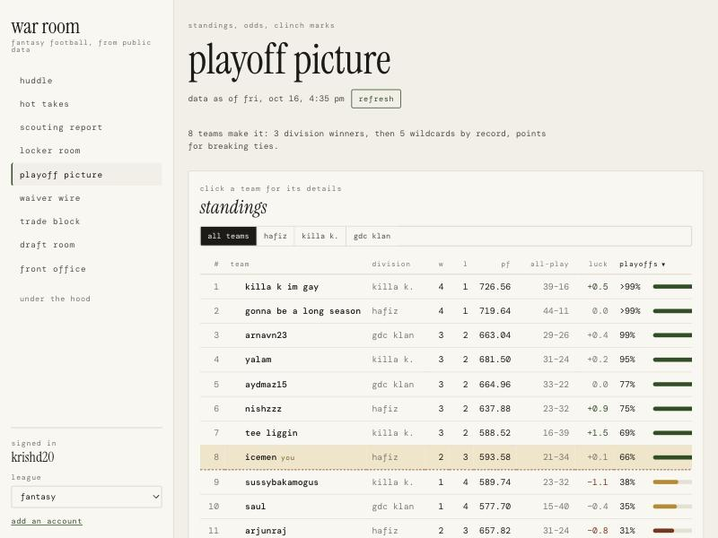

# the commish

A fantasy football web app for Sleeper leagues, built from free public data (Sleeper, nflverse, FantasyCalc).
It runs entirely in your browser: no account system, no server, and no AI or paid services at runtime.
Every number on screen traces to one of those sources, and every "take" comes from a fixed rule.

**Live:** https://krishdave20.github.io/the-commish/ — check in with any Sleeper username.



## What's in it

| Page | What it does |
|---|---|
| **huddle** | Changes with the season: playoff odds and magic number, this week's matchup, start/sit alerts, waiver adds and your takes in season; dynasty movers, rookie class, roster ages and league history in the offseason; a countdown, prep checklist and quick mock before the draft. Preview any phase with `#/?phase=offseason`. |
| **hot takes** | Rule-based takes from real numbers (usage spikes, target hogs, buy-lows, sell-highs, matchup edges…). Each card shows its stat line, sample size, why it matters to you, and its 2025 backtest record. |
| **scouting report** | Search every player; profiles with game log, projection range, usage trends, FTN charting splits, 2025 route and coverage splits, trade value and a watchlist. |
| **locker room** | Your roster and best lineup for any week, start/sit alerts, and **the lab** (what if a player returns, scores more, or you add/drop). |
| **playoff picture** | Standings with all-play and luck, playoff/division/title/flush odds from 20,000 simulated seasons, strict clinch marks, seeding odds, the magic number, the **playoff machine** (pick winners, watch it move), and interactive **brackets**: the ’ship and the toilet bowl (losers advance; the worst team is crowned). |
| **waiver wire** | Lineup lift by window (rest of season, next week, playoff weeks), FAAB bids, trending adds and usage risers. |
| **trade block** | Score any trade on lineup points and playoff odds; handshake deals (win-win ideas); dynasty mode with FantasyCalc values, future picks and a contender-or-rebuilder lens. |
| **draft room** | Rankings (value over replacement, tiers, ADP), mock drafts with a grade, and **on the clock**, a live draft assistant (with a replay of your league's last draft). Redraft, dynasty startup and rookie modes. |
| **front office** | Linked accounts, cache, the **injury report** (health of every data source and unmatched player IDs), the losers-bracket setting, credits. |
| **under the hood** | How the model works and how well it has done. |

## How it works

- **Data.** Sleeper and FantasyCalc are read straight from the browser and cached in IndexedDB (gzipped), with a "data as of" stamp everywhere and stale-cache fallback when offline. nflverse files don't allow browser access, so a **nightly GitHub Action** (`.github/workflows/pages.yml`) downloads them, joins player IDs to Sleeper, and publishes ~0.5 MB of JSON next to the site.
- **Model.** A port of the tested reference engine in `reference/`: Sleeper projections scored with your league's settings, calibrated floors and ceilings, matchup grades, a lineup optimizer, a seeded 20,000-run season simulation in a Web Worker, strict clinch math, waiver and trade evaluation. A regression test runs the original reference page in jsdom and requires the port to match it (it matches to 0.005 points).
- **Research.** Python lives only in notebooks: `notebooks/projection_bakeoff.ipynb` (why the plain projection wins), `notebooks/xtd_model.ipynb` (expected touchdowns), `notebooks/takes_thresholds.ipynb` (backtests each take detector on 2025).
- **Deviations from SPEC.md** (it describes an Electron app called War Room) are all recorded in `docs/WEB_APP_NOTES.md`.

## Develop

Requires Node 22+.

```bash
npm install
npm run dev
```

```bash
npm test          # vitest: unit, fixture and UI tests
npm run lint      # oxlint + TypeScript
npm run e2e       # Playwright smoke test against the built site (run `npm run e2e:install` once)
npm run dist      # static build in dist/
```

Optional, for nflverse panels in local dev:

```bash
npm run data:nflverse -- --out public/data/nflverse
```

Tests run offline from a saved snapshot of one real league in `reference/fixture/` (refresh it with `npm run fixture:capture -- --user <username> --league <league_id>`). Nothing in the app is hard-coded to that league.

## Deploy

Every push to `main` runs lint, tests and the smoke test, builds the site, runs the nflverse pipeline and deploys to GitHub Pages. The same workflow runs nightly to refresh the data, and keeps itself enabled through quiet offseasons. If the data job fails, the deploy is skipped and the last good site stays up.

## Credits

League data: Sleeper public API. Play-by-play and snap data: nflverse. Charting data: FTN Data via nflverse. Values: FantasyCalc.
Fonts: DM Mono and Instrument Serif (SIL Open Font License).
