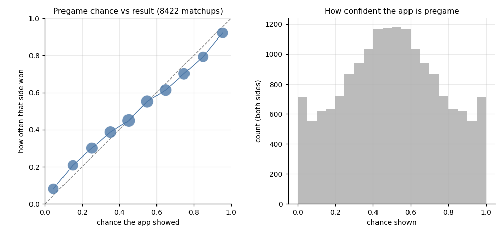
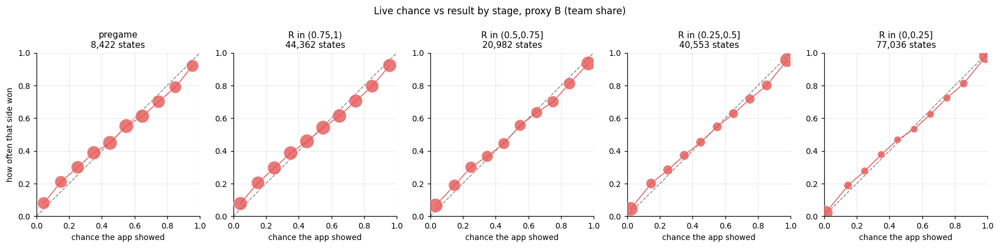
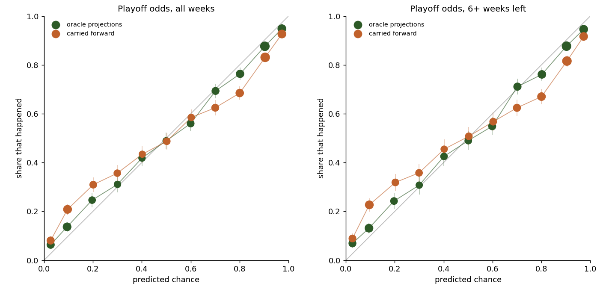
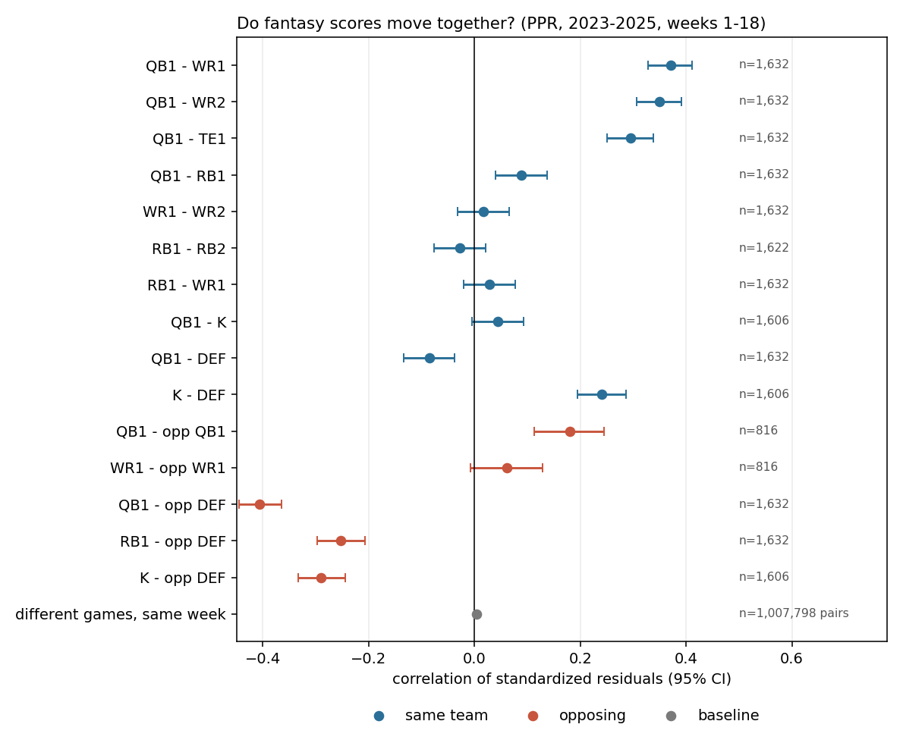
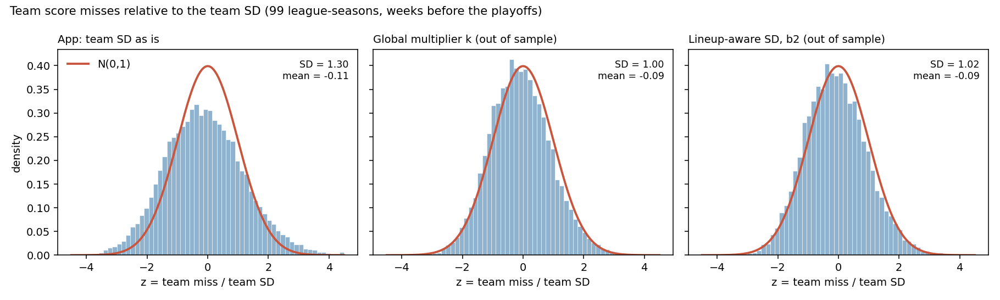
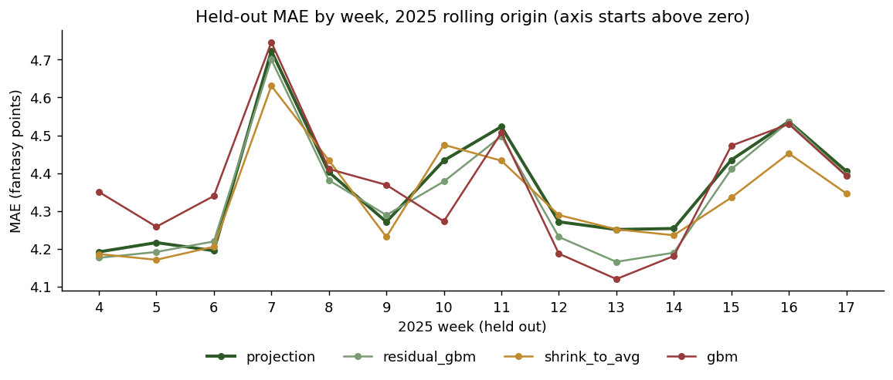

# Model validation: are the commish's probabilities trustworthy?

October 18, 2026. Evidence for the owner's question "are the models good enough to represent fantasy?". Nothing in the app was changed;
the changes below are recommendations.

**Short answer.** The models carry real information and beat every simple baseline, but **every probability the app shows is
too confident**, for the same reason everywhere: the team weekly SD (about 18.6 points) is about 25-30% too small. One change to a
single constant fixes most of it.

| What | Notebook | Verdict |
|---|---|---|
| Player projections (Sleeper) | `projection_bakeoff_2025.ipynb`, `projection_bakeoff_refresh.ipynb` | Keep. Full 2025 season: MAE 4.37; two light corrections beat it by only 0.03 (0.7%). 2026 wk 4-5: 4.39, best of four |
| Floor / ceiling bands | same | 58.9% coverage over 2025 (app's 4-week window), 58.6% in 2026, vs 60% target: fine |
| xTD model | `xtd_model.ipynb` (earlier) | Calibrated out of sample (455 predicted vs 450 TDs) |
| Weekly matchup win chance | `live_winprob_calibration.ipynb` | Useful, **overconfident** (slope 0.78) |
| Live (in-game) win chance | `live_winprob_calibration.ipynb` | Useful, **overconfident** by the same amount; the clock rule itself is right |
| Playoff / title / flush odds | `odds_calibration.ipynb` | Useful, **overconfident** (slope 0.80 / 0.72 / 0.74) |
| Independence of starters | `score_correlation.ipynb` | Real correlations exist (QB-WR 0.37) but explain only a small part of the gap |

How to read the numbers: **Brier score** is the mean squared error of a probability (lower is better; a coin flip scores 0.25).
**Calibration slope** comes from regressing what happened on the predicted log-odds: 1 = calibrated, **below 1 = overconfident**
(things the app calls 90% happen less than 90% of the time).

## Data

- **The owner's league.** Goon squad (2025) has 8 playoff spots for 8 teams, so its playoff odds are always 100%. It counts only
  for title and flush odds. No other finished league is reachable from the owner's account.
- **Extra leagues.** To get enough seasons, the notebooks use **104 finished league-seasons (2023-2025)**. They are the ordinary
  head-to-head leagues of the members of two public example leagues from the `ffscrapr` R package docs: 8-14 teams, no best ball,
  no median game, offense only.
  - They are mostly dynasty leagues from one circle of players.
  - Only aggregates are reported, and other leagues show up as hashes.
  - Raw API responses are cached in `notebooks/.cache/`, which is git-ignored.
- **Sample size.** 8,422 weekly matchups, 182,933 in-game states and 16,780 team-week playoff predictions.
- **Projection bake-off.** A full 2025 season (14 held-out weeks, 4,706 player-weeks), plus the 2026 weeks 4-5 re-run on fresh data.
  2026 week 6 was not final on October 18 (10 of 14 games complete), so it is not a test week yet;
  `projection_bakeoff_refresh.ipynb` adds it on a re-run after Monday night (October 19).

**Important data caveat: Sleeper rewrites old projections.** For a past week, Sleeper's projection endpoint returns a projection
that already knows who sat out. Across 2023, 2025 and the 2026 fixture, almost no players projected above 0.5 points failed to play
(5 of 6,174 in 2025), and the rows carry `last_modified` dates after the games. Before kickoff it is different: of the players the
fixture's Friday projection had above 0.5 points for week 6, 3.0% did not play. Consequences:

- every backtest here, the projection bake-offs and the app's own residual-SD calibration see slightly better projections
  than existed before kickoff. Measured on 2026 week 6: about **0.07 points of MAE** (4.80 before kickoff vs 4.72 rewritten, on the
  same players; see section 5);
- the real-time overconfidence is therefore a little **worse** than measured below;
- the correlation notebook estimates starters who sit add about 2.7% to team variance.

## 1. Weekly matchup win chance (also the engine inside the season simulation)



| | Brier | Log loss | Calibration slope (95% CI) | z-SD |
|---|---|---|---|---|
| Always 50% | 0.250 | 0.693 | – | – |
| App (`winProb`, team SD) | 0.200 | 0.582 | **0.78 (0.74-0.82)** | **1.25 (1.24-1.28)** |
| App with SD × 1.245 (out of sample) | 0.1999 | 0.5795 | 0.99 (0.94-1.04) | ~1.0 |

- **The app's calls are too strong.** When it shows 95%, that side wins 92%. Its 5% underdogs win 8%. Across all games, it shows
  favourites at 71.6% on average, and they win 68.5%.
- **The cause is the score spread.** The real score difference is 1.25 times wider than the model assumes (that ratio is the
  z-SD). It is the same in each season: 1.28 in 2023, 1.23 in 2024 and 1.24 in 2025.

## 2. Live win chance



There is no play-by-play timing here. In-game states are approximated at quarter boundaries from each game's kickoff time, and
"points so far" is built from the player's final points. Two versions were tested:

- **Proxy A (linear):** points so far = final points × elapsed share of the game.
- **Proxy B (team share):** points so far follow the NFL team's real quarter-by-quarter scoring.

Both use the final result to build the states, so the absolute live Brier is optimistic. The live slopes only point in a
direction.

| Starter-minutes left | Brier A | Brier B | Slope A | Slope B |
|---|---|---|---|---|
| over 75% | 0.186 | 0.190 | 0.84 | 0.79 |
| 50-75% | 0.142 | 0.154 | 0.92 | 0.77 |
| 25-50% | 0.106 | 0.114 | 0.87 | 0.77 |
| under 25% | 0.054 | 0.061 | 0.92 | 0.81 |
| all live | 0.107 | 0.115 | 0.89 (0.86-0.92) | 0.79 (0.77-0.82) |

- **The live chance is clearly useful.** "Whoever leads holds" scores a Brier of 0.26-0.27. Keeping the pregame number fixed
  scores 0.200.
- **The clock rule is right.** The square-root shrink (`sd × sqrt(R)`, where R is the share of starter-minutes still to play)
  fits best under both proxies, even when each alternative gets its own best SD (`alpha = 0.5` beats 0.75 and 1).
- **The overconfidence is inherited from the pregame SD.** The best SD multiplier is 1.1-1.25, the same direction and size as the
  pregame result.

## 3. Playoff, title and flush odds



**How the test works.** Each league-season is replayed from week 0 to the end of the regular season, standing where the app
would stand after each week. It uses the port of `sim.ts` plus the bracket from `bracket/season.ts`; replaying the real playoff
scores through the ported bracket picks Sleeper's real champion in 103 of 104 leagues.

Old future-week projections can't be fetched, so two versions bracket the app:

- **oracle:** the real per-week projections, which know a little of the future;
- **carried forward:** each player's latest projection reused for every later week, with no hindsight.

| Playoff odds (16,780 team-weeks, 103 league-seasons) | Brier (95% CI) | Log loss | Slope |
|---|---|---|---|
| App sim, oracle projections | **0.107** (0.096-0.118) | 0.338 | **0.80** |
| App sim, carried-forward projections | 0.128 | 0.398 | 0.66 |
| Same sim, no projections (records only) | 0.137 | 0.410 | 1.18 |
| Standings, smoothed (leave-one-league-out) | 0.142 | 0.432 | 1.01 |
| Standings, hard (in a playoff spot or not) | 0.194 | 1.270 | 0.21 |

| | Oracle Brier / slope | Records-only Brier | Uniform 1/teams Brier |
|---|---|---|---|
| Title | 0.070 / 0.72 | 0.074 | 0.079 |
| Flush (worst team) | 0.065 / 0.74 | 0.072 | 0.078 |

**The projections add real skill.** The sim beats the best standings baseline by 25% on Brier, and the gap is widest early in
the season: 0.148 vs 0.221 with 12 or more weeks left.

**The extremes are off.** Teams given about 3% make the playoffs 6% of the time, teams given 10% make it 14%, and teams given 97%
make it 95%. That is with the oracle projections. The live app sits between oracle (slope 0.80) and carried forward (0.66).

**The source is the team means, not the standings logic.** With projections switched off, the sim is slightly *under*confident.
The excess certainty comes from the narrow weekly SD (section 1), plus treating each team's projected strength as exact for the
rest of the season.

Prototypes, oracle projections:

| | Playoff log loss | Playoff slope | Title slope | Flush slope |
|---|---|---|---|---|
| App today | 0.3375 | 0.80 | 0.72 | 0.74 |
| Team SD × 1.4 | **0.3303** | 0.97 | 0.87 | 0.93 |
| Team SD × 1.2 | 0.3320 | 0.89 | – | – |
| Per-team strength shock, τ = 8 pts | 0.3326 | 1.01 | 0.87 | 0.88 |

- **SD multiplier.** In 300 league bootstraps the best multiplier was 1.4 or 1.6 in 86% of draws, and 1.0 in only one.
- **The strength shock alone does not fix it.** The shock (one Normal(0, τ) draw per team per simulated season) gets the overall
  slope right but over-corrects early (1.14 with 12 or more weeks left) and under-corrects late (0.89 with 1-3 weeks left).
- **Owner's league, a story rather than a test.** From week 4 on, the eventual goon squad champion had a 37-55% title
  chance (a 1-in-8 guess is 12.5%). The title log loss on that league is 0.19 against 0.38 for a 1-in-8 guess.

## 4. Correlation: how much does "starters are independent" miss?



**Strong pairs exist.** Residual correlations (actual minus projected, 2023-2025, 95% CIs):

- QB with his WR1: 0.37 (0.33-0.41)
- QB with his WR2: 0.35
- QB with his TE: 0.30
- K with his own DEF: 0.24
- QB against the opposing DEF: -0.41
- QB with the opposing QB: 0.18
- RB-RB, WR-WR and RB-WR on the same team: about 0
- players in different games: 0.004

**But they explain only a small part of the gap.** Real lineups rarely stack: 31% start a QB with one of his own receivers, and
the average lineup has 1.5 same-team pairs. All the covariances together inflate team variance by a factor of 1.09 (1.07-1.11),
about 1.04 on the SD. That breaks down as:

- same-NFL-team pairs: +2.9%
- opposite sides of one game: +0.7%
- a league-wide weekly factor: +5.3%



**The bigger miss is the per-player SD itself.** Across 99 league-seasons, a lineup's real miss has an SD of **24.2 points**
against the app's **18.7**, a ratio of 1.30 (1.28-1.31). Most of that, a factor of 1.23 on the SD, comes from where the
positional SDs are fitted.

- The app fits them on *everyone* projected above 0.5 points.
- Starters are the high-projection players, and their misses are larger: about 7 points for an RB, WR or TE, against the 5-6 the
  app uses.
- Variance grows by about 4-5 points² per projected point for RB, WR and TE, and 2-2.5 for QB.

**For a matchup, the needed stretch is smaller.** The two opponents' misses are slightly correlated (0.08, through the weekly
factor), so the right multiplier for win chances is **about 1.25**, not 1.30. Out of sample, that brings the pregame slope from
0.78 to 0.99.

**A lineup-aware version did no better.** It scales each starter's SD with his projection and adds the same-team covariances,
the weekly factor and the chance a starter sits. It reaches slope 1.00, and its log loss is not distinguishable from the plain
multiplier (difference -0.0006, CI -0.0013 to +0.0002). Adding only the teammate covariances barely helps (slope 0.82).

**Bias.** Starters score 2.3 points per team-week under projection on average (9 points under in 2025). This cancels inside a
matchup, so it does not affect win chances.

## 5. Player projections and floor / ceiling bands

The question: does anything beat Sleeper's own weekly projection as the player mean? Four candidates from the reference notebook, rolling
origin (each test week predicted from earlier weeks only), MAE in fantasy points per player-week, players projected above 0.5.

| Candidate | 2025, weeks 4-17 (14 weeks) | 2026, weeks 4-5 (fresh data) |
|---|---|---|
| Plain projection | 4.365 (won 1 of 14 weeks) | **4.390** |
| Projection + 0.3 × GBM residual fix | 4.340 (won 2) | 4.424 |
| Shrink toward season average, `gp / (gp + 10)` | **4.334** (won 7) | 4.468 |
| Gradient boosting on form, snaps, matchup | 4.367 (won 4) | 4.667 |



- **Over a full season the plain projection does not win, but nothing beats it by much.** Shrink-to-average and the residual fix are
  better by 0.033 and 0.025 points. Resampling whole weeks, both intervals exclude zero (−0.056 to −0.008 and −0.040 to −0.010).
- **The gain is too small to matter.** 0.03 points per player is about 0.3 points per 9-man lineup per week, inside a team SD of about 19.
  Some 40% of it comes from quarterbacks, where Sleeper's 2025 projections were weakest (MAE 6.58).
- **Early season favours the projection.** The full GBM is worst in weeks 4-9 and best of all in weeks 10, 12, 13 and 14, as its training set grows. The
  2026 result (projection first) is the early-season picture.
- **2026 weeks 4-5 reproduce exactly from fresh data.** Sleeper had not changed those projections since the fixture was captured (0 of 690).
- **Floors and ceilings are fine.** Over 2025, with the app's own last-4-weeks fit, 58.9% of actuals land inside the 20th-80th band
  (target 60%). 21.3% fall below the floor and 20.3% above the ceiling, and every position is between 57% and 61%. 2026 weeks 4-5: 58.6%.
- **Caveat: all of these MAEs are on rewritten projections** (see Data). On 2026 week 6 the rewrite is worth about 0.07 points of MAE,
  more than the 0.03 any candidate gains. So the ranking is a fair comparison on equal inputs, but the level is optimistic. Whether
  shrink-to-average still helps on real pre-kickoff projections is unknown until snapshots exist (recommendation 5).

**Verdict: keep the plain projection.** If the app ever wants a correction, shrink-to-average is the one to try (one line, no model), after
a re-test on pre-kickoff snapshots.

## What's trustworthy, what isn't

**Trust**
- The projections (no candidate beats them by more than 0.7% over a full season) and the floor/ceiling bands.
- The ranking information in every probability. Favourites, contenders and likely flushes are identified well above baseline, and
  title odds especially early in the season.
- The live clock logic, `sd × sqrt(R)`.
- The bracket mechanics.

**Overconfident**
- Every probability built on the team SD: weekly win chance, live win chance, playoff, title and flush odds.
- The error is largest where users look hardest: "97%" is really about 95%, "3%" is really about 6%, and "95% to win this week" is
  really about 92%.

**Not tested**
- Trade, waiver and draft values.
- Divisional tiebreakers beyond wins and points-for (Sleeper's own tiebreaks may differ; it agreed on the champion in 103 of 104
  leagues).
- Live accuracy on real play-by-play.

## Recommended engine changes (for the owner and main session to decide)

1. **Raise the default `volatility` to 1.25.** This is the multiplier on `teamWeeklySd`, and `sim.ts` and `simInput.ts` already
   have it.
   - *Expected impact:* the weekly win chance goes from slope 0.78 to about 1.0, with log loss -0.005 (CI excludes 0).
   - Season odds move most of the way to calibrated: slope 0.80 becomes about 0.9, based on the k sweep at 1.2.
   - The live win chance improves by the same factor, since it uses the same `sd`.
   - What users see: a 60/40 matchup shows 58/42, 70/30 shows 66/34, and 80/20 shows 75/25.
   - *Risk:* very low. The control already exists, and the default changes one constant.
   - Also update any tests that pin odds to the reference engine.
2. **Later, the principled version: fit each starter's SD to his projection** (σ² ≈ a + b·projection per position) instead of one
   positional SD over all players.
   - *Expected impact:* the same calibration as change 1 (slope 1.00), and it adapts to leagues with deeper or shallower lineups.
   - It also lets floors and ceilings widen for stars.
   - *Cost:* a change in `model.ts`'s calibration block, plus new regression fixtures.
3. **Optional, after change 1: a per-team strength shock in the season sim** for long horizons. One Normal(0, τ) draw per team per
   run, added to every future week.
   - *Expected impact:* small log-loss gain (0.005 at τ = 8 alone, CI includes 0).
   - It fixes early-season playoff odds more than late.
   - It was not tested together with change 1, so re-run `odds_calibration.ipynb` with both before adopting it.
4. **No correlation term needed now.** QB-stack covariances move the slope only from 0.78 to 0.82. Add them only if the app ever
   shows a single team's score range for stacked lineups.
5. **Snapshot projections before kickoff.** The nightly GitHub Action could store each week's Sleeper projections before games
   start.
   - *Expected impact:* honest real-time backtests. Today's bake-off MAE and every calibration here are flattered by Sleeper's
     after-the-fact revisions.
6. **Re-run `projection_bakeoff_refresh.ipynb` once 2026 week 6 is final** (after Monday night, October 19) to add week 6 as a
   2026 test week and complete the rewrite measurement on all 14 games. The full-season 2025 bake-off is done (section 5).

## Reproduce

All five notebooks run end to end with saved outputs:

```
cd notebooks
/opt/anaconda3/bin/jupyter nbconvert --to notebook --execute --inplace odds_calibration.ipynb
/opt/anaconda3/bin/jupyter nbconvert --to notebook --execute --inplace live_winprob_calibration.ipynb
/opt/anaconda3/bin/jupyter nbconvert --to notebook --execute --inplace score_correlation.ipynb
/opt/anaconda3/bin/jupyter nbconvert --to notebook --execute --inplace projection_bakeoff_2025.ipynb
/opt/anaconda3/bin/jupyter nbconvert --to notebook --execute --inplace projection_bakeoff_refresh.ipynb
```

- **Run time:** the first run downloads about 2,900 small API responses into the cache (about 3.5 minutes). Then they take about
  1.5-3 minutes, 2 minutes and 20 seconds; the two bake-offs take about 1 minute and 15 seconds (the 2025 one reuses the same cache).
- `projection_bakeoff_refresh.ipynb` always fetches the NFL state and scores live, and caches a week's stats and projections only once
  every game that week is final. Its results change as the 2026 season goes on.
- **Charts** are written to `docs/validation/`.
